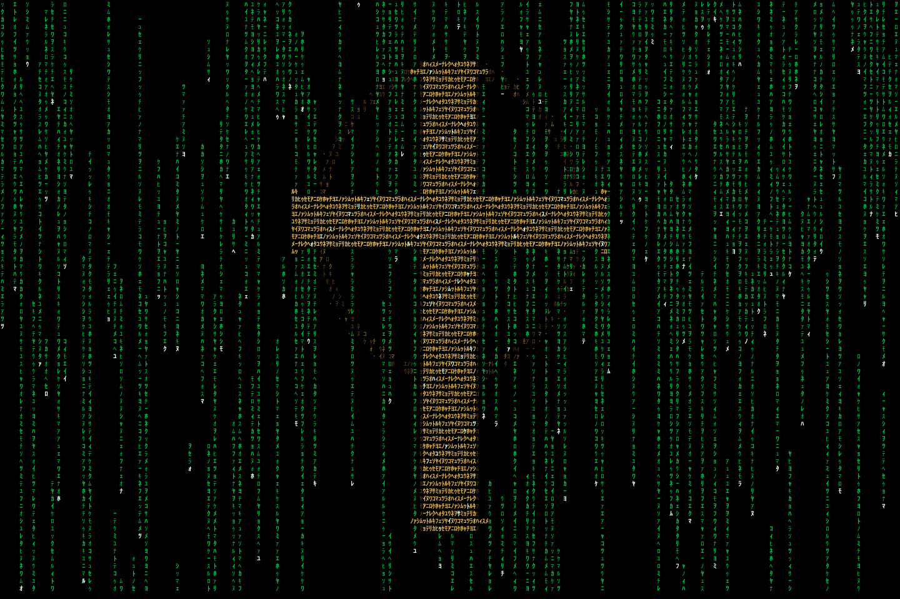

# cmatrix-christ

A fork of [CMatrix](https://github.com/abishekvashok/cmatrix) with a traditional
Christian cross formed from live Japanese code. The cross, gold edges, double
nimbus, flared terminals and moving glints are drawn by ncurses itself. Normal
CMatrix behavior remains available when `CMATRIX_CROSS` is unset.



## Build and run this fork

Install a C compiler, make, pkg-config and the wide-character ncurses development
package. The optional smoke tests also require Python 3.

```sh
make -f Makefile.christ
CMATRIX_CROSS=1 ./build/cmatrix -a -b -c -u 2 -C green
make -f Makefile.christ test
```

`-c` selects half-width Japanese kana, `-a` gives streams independent speeds,
`-b` enables bold highlights, and `-u 2` sets the update delay to 20 milliseconds.
Use a UTF-8 locale and a font with Japanese support, such as IPAGothic. This fork
also fixes wide-character rendering of stream heads. The terminal palette controls
colors; the optional Wayland integration supplies the gold and theme palettes.

The code cross scales with terminal geometry. More pixels on a larger output allow
a finer code grid; the built-in Sharkdeck panel remains at its native 480×320.
The capture above was rendered separately at 1440×960.

## Optional Sway lock screen and theme picker

`contrib/sharkdeck` contains the actual per-user integration used on the deck:

- Matrix Movie, Purple & Blue, and Gruvbox Dark palettes.
- A searchable theme picker and a separate unlocked preview window.
- Real cmatrix in a GTK 3/VTE terminal, embedded through windowtolayer.
- A swaylock-plugin password lock, with standard swaylock as a startup fallback.
- A single-instance idle manager that locks after ten minutes without changing
  display power. Existing Sway idle inhibitors are respected.

Dependencies are Python 3, PyGObject, GTK 3, VTE 2.91 introspection, IPAGothic,
fuzzel, swayidle, swaylock, [swaylock-plugin](https://github.com/mstoeckl/swaylock-plugin)
and [windowtolayer](https://gitlab.freedesktop.org/mstoeckl/windowtolayer).
The locker must have a working `swaylock-plugin` PAM service on your system.
This repository does not install PAM policy or change account passwords.

On Alpine, the packaged portion of these dependencies can be installed with:

```sh
doas apk add build-base pkgconf ncurses-dev python3 py3-gobject3 gtk+3.0 vte3 font-ipa fuzzel swayidle swaylock
```

Install the integration into your own home directory after building and installing
the two external Wayland helpers:

```sh
python3 contrib/sharkdeck/install.py
```

The installer copies user scripts and launcher entries to `~/.local`, generates
the selected theme, and preserves an existing `~/.config/swaylock/config`.
It does not edit or reload Sway configuration. Review and add these bindings to
Sway to enable the features you want:

```sway
bindsym $mod+BackSpace exec ~/.local/bin/sharkdeck-lock
bindsym $mod+Ctrl+t exec ~/.local/bin/sharkdeck-lock-theme
exec_always --no-startup-id ~/.local/bin/sharkdeck-idle
```

Replace an existing lock binding or idle power-off configuration rather than
running duplicate idle managers. Check your account password and locker setup
before enabling automatic locking.

Search your application launcher for **Lock Screen Themes** or **Preview Lock
Animation**. Escape or Q closes the unlocked preview. Theme changes apply to the
next lock or preview. The code cross is part of cmatrix, while password entry is
handled only by the surrounding locker.

## License and upstream

GPL-3.0-or-later, as in upstream CMatrix. Original copyright notices and `COPYING`
are retained. The upstream README follows for the original build systems and
terminal controls.

---

<h1 align="center">CMatrix</h1>

<h3 align="center"> Matrix like effect in your terminal </h3>

</p>
<p align="center">
  <a href="https://travis-ci.org/abishekvashok/cmatrix">
    
  </a>
  <a href="./COPYING">
    
  </a>
  
  <a href="https://github.com/abishekvashok/cmatrix/stargazers">
    
  </a>
  <a href="https://github.com/abishekvashok/cmatrix/network">
    
  </a>
</p>


## Contents
- [Overview](#overview)
- [Build Dependencies](#build-dependencies)
- [Building and Installation](#building-and-installing-cmatrix)
    - [Using configure (recommended)](#using-configure-(recommended-for-most-linux%2Fmingw-users))
    - [Using CMake](#using-cmake)
- [Usage](#usage)
- [Captures](#captures)
    - [Screenshots](#screenshots)
    - [Screencasts](#screencasts)
- [Maintainer](#maintainers)
    - [Contributors](#our-contributors)
- [Contribution Guide](#contribution-guide)
- [License](#license)


## :cloud: Overview

CMatrix is based on the screensaver from The Matrix website. It shows text
flying in and out in a terminal like as seen in "The Matrix" movie. It can
scroll lines all at the same rate or asynchronously and at a user-defined
speed.

CMAtrix is inspired from 'The Matrix' movie. If you haven’t seen this movie and you are a fan of computers or sci-fi in general, go see this movie!!!

> :grey_exclamation:`Disclaimer` : We are in no way affiliated in any way with the movie "The Matrix", "Warner Bros" nor
any of its affiliates in any way, just fans.


## :open_file_folder: Build Dependencies
You'll probably need a decent ncurses library to get this to work. On Windows, using mingw-w64-ncurses is recommended (PDCurses will also work, but it does not support colors or bold text).
<br>
##### :small_blue_diamond: For Linux<br>
Run this command to check the version of ncurses.
```
ldconfig -p | grep ncurses
```
If you get no output then you need to install ncurses. Click below to install ncurses in Linux.
- [ncurses](https://www.cyberciti.biz/faq/linux-install-ncurses-library-headers-on-debian-ubuntu-centos-fedora/)


## :floppy_disk: Building and installing cmatrix
To install cmatrix, Clone this repo in your local system and use either of the following methods from within the cmatrix directory.

#### :small_blue_diamond: Using `configure` (recommended for most linux/mingw users)
```sh
autoreconf -i  # skip if using released tarball
./configure
make
make install
```

#### :small_blue_diamond: Using CMake
Here we also show an out-of-source build in the sub directory "build".
(Doesn't work on Windows, for now).
```sh
mkdir -p build
cd build
# to install to "/usr/local"
cmake ..
# OR 
# to install to "/usr"
#cmake -DCMAKE_INSTALL_PREFIX=/usr ..
make
make install
```


## :bookmark_tabs: Usage

After you have installed **cmatrix** just type the command `cmatrix` to run it :)
```sh
cmatrix
```
Run with different arguments to get different effects.
```sh
cmatrix [-abBflohnsmVx] [-u update] [-C color]
```
Example:
```sh
cmatrix -ba -u 2 -C red
```

For more options and **help** run `cmatrix -h` <br>OR<br> Read Manual Page by running command `man cmatrix`

_To get the program to look most like the movie, use `cmatrix -lba`_
_To get the program to look most like the Win/Mac screensaver, use `cmatrix -ol`_

> :round_pushpin: _Note: cmatrix is probably not particularly portable or efficient, but it won't hog
**too** much CPU time._


## :camera: Captures

#### :small_blue_diamond: Screenshots

<!--  -->
<p align="center">

</p>

#### :small_blue_diamond: Screencasts

<!--  -->
<p align="center">

</p>


## :zap: Maintainers
- ➤ **Abishek V Ashok** [Core] - <abishekvashok@gmail.com><br> 
<p align="center">
  <a href="https://twitter.com/abishekvashok">
    
  </a>
  <a href="https://github.com/abishekvashok">
    
  </a>
</p>


## :busts_in_silhouette: Our Contributors
#### :small_orange_diamond: Thanks to
- ➤ **Chris Allegretta** <chrisa@asty.org> for writing cmatrix up in a fortnight and giving us
  the responsibility to further improve it.
- ➤ **Krisjon Hanson** and **Bjoern Ganslandt** for helping with bold support and
  Bjoern again for the cursor removal code, helping with the `-u` and `-l`
  modes/flags, and Makefile improvements.
- ➤ **Adam Gurno** for multi-color support.
- ➤ **Garrick West** for debian consolefont dir support.
- ➤ **Nemo** for design thoughts and continuous help and support.
- ➤ **John Donahue** for helping with transparent term support
- ➤ **Ben Esacove** for Redhat 6 compatibility w/matrix.psf.gz
- ➤ **jwz** for the xmatrix module to xscreensaver at http://www.jwz.org/xscreensaver.
- Chris Allegretta's girlfriend **Amy** for not killing him when he stayed up till 3 AM
  writing code.
- ➤ **Sumit Kumar Soni** for beautifying the README.
- The makers of the Matrix for one kickass movie!
- ➤ Everyone who has sent (and who will send) us and Chris mails regarding
  bugs, comments, patches or just a simple hello.
- ➤ Everyone who has contributed to the project by opening issues and PRs on the github repository.


## :book: Contribution Guide
If you have any suggestions/flames/patches to send, please feel free to:
- Open issues and if possible label them, so that it is easy to categorise features, bugs etc.
- If you solved some problems or made some valuable changes, Please open a Pull Request on Github.
- See [contributing.md](./CONTRIBUTING.md) for more details.


## :page_facing_up: License
This software is provided under the GNU GPL v3. [View License](./COPYING)

